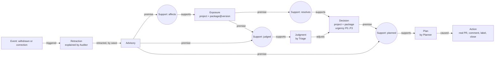

# Retcon

**Agent memory that can take things back.**

Retcon is a team of agents whose memory is a [FalkorDB](https://www.falkordb.com/) graph in which every belief and every decision records what supports it. It watches real security advisories for real open-source projects, turns them into real GitHub pull requests, and when an advisory is withdrawn or a person corrects a belief, it revises exactly the work that rested on it, and nothing more.

- **Live app:** https://retcon-kappa.vercel.app
- **Real PRs it opened, rewrote, downgraded and closed:** [retcon-target-gladys](https://github.com/Rudransh-1508/retcon-target-gladys/pulls?q=is%3Apr) and [retcon-target-wiredoor](https://github.com/Rudransh-1508/retcon-target-wiredoor/pulls?q=is%3Apr)
- **Spec and tickets:** [#1](https://github.com/Rudransh-1508/retcon/issues/1) and its sub-issues
- **Glossary:** [CONTEXT.md](CONTEXT.md)

## The problem

Advisories are not final. In GitHub's npm and PyPI advisory data, 635 advisories have been withdrawn, 131 of them for reasons other than being a duplicate:

- **jsonwebtoken (CVE-2022-23529):** claimed remote code execution in one of npm's most used packages. Live for 36 days, then withdrawn.
- **axios (GHSA-rm8p-cx58-hcvx):** withdrawn after a day because the flaw sits in `form-data`, and patching `form-data` is enough.
- **express (GHSA-pj86-cfqh-vqx6):** withdrawn because it "describes a correctness bug, not a vulnerability".

Teams act on advisories fast: hotfixes, upgrade PRs, blocked releases. When a claim is withdrawn, nobody can say which of that work rested on it. Stale work stays open, or a naive tool undoes too much and closes work that other, still valid advisories justify.

Agent memory has the same flaw. It stores conclusions without their reasons, so it cannot be revised correctly.

## How Retcon works

Every Exposure, Judgment and Decision is **held only while at least one of its Supports holds**, and a Support holds only while **all of its premises** are held. This is a truth maintenance system ([Doyle, 1979](https://doi.org/10.1016/0004-3702(79)90008-0)) on a graph database, shared by several LLM agents.



When an advisory is withdrawn (or a person corrects any belief), the retraction propagates forward wave by wave. Every decision it reaches gets an **Outcome**:

- **Cancel:** no support left. The PR is closed with an explanation.
- **Downgrade:** support left, lower urgency. The PR stays open, relabelled, with a comment.
- **Unchanged:** other advisories still hold it up. The PR text is rewritten; nothing else happens.

Nothing is ever deleted, so for any decision you can ask **"why?"** and see the full chain, including what was retracted, when, and why.

### The agents

| Agent | What it does | Model |
|---|---|---|
| **Triage** | Finds where the project imports the affected package and calls the API the advisory names, then judges "exploitable here", "not reachable here" or "unknown", citing file and line. A held judgment moves its advisory's weight by one level. | Groq `gpt-oss-120b` |
| **Planner** | At each decision point (a new upgrade, an escalation, a downgrade, a retracted plan, a cancelled upgrade that comes back) it chooses among the allowed actions: open a pull request, list it in the report, keep, reopen, or move a pull request to the report. Its choice is recorded as a **Plan** resting on the evidence it saw, so when that evidence is withdrawn the Plan is retracted and the Planner plans again. Anything outside the allowed actions falls back to a fixed **Policy**. | Groq `gpt-oss-120b` |
| **Fixer** | Writes the prose of pull requests and comments from the decision, its plan and its why() chain. Titles, tables, links and markers stay deterministic. | Groq `gpt-oss-120b` |
| **Auditor** | Reads every withdrawal, classifies it (real retraction, duplicate, alias, scope change) and explains the retraction. The graph decides outcomes; the Auditor only explains them. | Groq `gpt-oss-120b` |

The memory rules themselves (what holds, what is retracted) are never left to an LLM, and a Cancel always closes the pull request: no agent can keep work open once every advisory behind it is withdrawn.

Agents never write a belief without naming its support. The engine rejects it.

### What the real data does

Replaying the real 2019 to 2026 advisory history against the two projects (568 events, about 30 seconds locally):

- **wiredoor, axios:** a PR opens on 2025-07-23 for the "transitive critical" advisory, closes the next day when it is withdrawn (the form-data PR is untouched), and reopens in September when new axios advisories arrive.
- **gladys, jsonwebtoken:** four advisories land on 2022-12-22. Triage reads Gladys's code and judges the RCE claim *not reachable here*: `jwt.verify` gets the server's own `this.jwtSecret`, never attacker input. So Retcon never panics: the upgrade is P1, held up by the other HIGH advisory. When the RCE claim is withdrawn on 2023-01-27, Triage's judgment is retracted with it (it rested on that advisory), and the PR stays open, rewritten to show three advisories that still hold.
- **wiredoor, express:** the express advisory is withdrawn and the decision, held up by nothing else, is cancelled.
- **Duplicates** (about 80% of withdrawals) are linked to their original and count as the same evidence, so withdrawing one changes nothing and touches nothing on GitHub.

## Try it

1. Open https://retcon-kappa.vercel.app/app and pick a decision. The **Why?** panel shows its chain of support and its history.
2. Press **What if wrong?** on any advisory, exposure or judgment. Retcon copies the graph (`GRAPH.COPY`), applies the retraction to the copy, shows what would change, and deletes the copy.
3. Open **Graph**, pick a project, and **replay a retraction**: the graph is a 3D stack of plates (advisories, exposures, judgments, decisions, plans) you can orbit, and the recorded propagation waves travel up through it.
4. Open **Agents** to see one feed of everything each agent did: Triage judgments, Planner plans (struck through when retracted or superseded), Auditor explanations, and the pull requests and comments they caused.
5. Open **Timeline** to follow every withdrawal and correction, with the Auditor's explanation.

## Use Retcon from your own agent (MCP)

Retcon's memory is an MCP server, so any agent can ask it why, and what if:

| Tool | What it does |
|---|---|
| `decisions(project?, urgency?)` | Upgrades Retcon holds, most urgent first, with their pull requests |
| `why(id)` | The chain of support behind a decision, judgment, plan or advisory, including what was retracted and the agents' plans |
| `what_if(id)` | What would change if an advisory, exposure or judgment were wrong; runs on a copy of the graph and writes nothing |
| `timeline(limit?, only_retractions?)` | Recent withdrawals and corrections, with what each changed and the Auditor's explanation |
| `correct(id, reason)` | Retract a belief for real (local server only, needs the admin passphrase) |

Remote, read only:

```bash
claude mcp add --transport http retcon https://retcon-kappa.vercel.app/mcp
```

Local, with `correct` (uses the FalkorDB settings and passphrase from `.env`):

```bash
claude mcp add retcon -- uv --directory /path/to/retcon run python -m retcon.mcp_server
```

Then ask, for example: *"Using retcon, why is there an open pull request for jsonwebtoken in gladys, and what would change if GHSA-8cf7-32gw-wr33 were wrong?"*

## Graph data model and the queries Retcon depends on

**Nodes:** `Project`, `PackageVersion`, `Advisory`, `Exposure`, `Judgment`, `Decision`, `Plan`, `Action`, `Support`, `Event`, `Retraction`, `Agent`. The beliefs (`Advisory`, `Exposure`, `Judgment`, `Decision`, `Plan`) also carry the `Belief` label.

**Relationships:** `(Support)-[:PREMISE]->(node)` and `(Support)-[:SUPPORTS]->(belief)` carry the reasons. `(Agent)-[:WROTE]->(Support)` records who wrote a reason. `(Retraction)-[:RETRACTED {wave}]->(node)` records every retraction wave. Others: `DEPENDS_ON`, `DUPLICATE_OF`, `ALIAS_OF`, `ADJUSTS`, `TRIGGERED`, `ABOUT`, `CHANGED`, `CAUSED`.

**The rule:** a belief is held while at least one of its Supports is held, and a Support is held while all of its premises are held. A write that names no premises is rejected.

**Retraction (the core algorithm).** Mark the withdrawn advisory retracted, then repeat these two queries until neither changes anything. Each round is one wave:

```cypher
// 1. A Support dies when any of its premises is retracted
MATCH (s:Support {status: 'held'})-[:PREMISE]->(p:Node {status: 'retracted'})
WITH DISTINCT s SET s.status = 'retracted', s.retracted_at = $at RETURN s.id

// 2. A belief dies when no held Support is left
MATCH (b:Belief {status: 'held'})
OPTIONAL MATCH (b)<-[:SUPPORTS]-(s:Support {status: 'held'})
WITH b, count(s) AS held WHERE held = 0
SET b.status = 'retracted', b.retracted_at = $at RETURN b.id
```

**Recomputing every held decision (urgency, evidence, target version)** from the advisories that still hold, in one traversal and one batched write:

```cypher
MATCH (d:Decision {status: 'held'})<-[:SUPPORTS]-(:Support {status: 'held'})
      -[:PREMISE]->(e:Exposure {status: 'held'})<-[:SUPPORTS]-(s:Support {status: 'held'})
      -[:PREMISE]->(a:Advisory {status: 'held'})
RETURN d.id, collect(DISTINCT [a.evidence, a.rank, s.fix, a.id])
```

**What-if** runs the real retraction on a throwaway clone and deletes it, so the live graph is never written: `GRAPH.COPY <graph> <scratch>`, retract on `<scratch>`, diff the decisions, then delete `<scratch>`.

**Why?** walks `PREMISE` and `SUPPORTS` from a decision back to its advisories, including retracted nodes, because nothing is ever deleted. Writes are idempotent (`MERGE`, with an index on `id` per label), so the graph can be rebuilt from the advisory feed. The code is in `retcon/engine.py`.

## Built with AI assistance

Retcon was built with Claude Code (Anthropic) as a coding assistant, for implementation, tests and the web UI, as the hackathon rules allow when disclosed.

## Architecture (all free tier)

| Piece | Where |
|---|---|
| Graph | FalkorDB Cloud. The graph can always be rebuilt from the feed, so a restart of the free instance is harmless. |
| Worker | A scheduled GitHub Actions workflow (every 10 minutes, plus manual `run` and `reset`). |
| API and UI | Vercel: FastAPI serverless functions, and a Next.js static export in `web/` (the landing page at `/` and the console at `/app`, with the 3D graph in three.js). |
| LLMs | Groq, with a key pool, rotation, backoff and a fallback model. |
| Advisory feed | The public OSV bucket: the npm archive on rebuild, the modified-id index after that. OSV's query API omits withdrawn advisories, so it cannot be used. |
| GitHub | A fine-grained token limited to the two target repositories. The code also refuses any other repository. |

The demo targets are snapshot copies (not forks, so nothing can ever reach upstream) of [GladysAssistant/Gladys](https://github.com/GladysAssistant/Gladys) at `7eb0b2a` (2022-12-18) and [wiredoor/wiredoor](https://github.com/wiredoor/wiredoor) at `e80904f` (2025-07-17), both Apache-2.0.

## Running locally

```bash
docker run -d -p 6390:6379 falkordb/falkordb:latest   # tests and local dev use port 6390
uv sync
uv run pytest                                          # scenario tests against real FalkorDB
FALKORDB_HOST= RETCON_GRAPH=dev uv run python -m retcon.cli run --dry-run   # replay without touching GitHub
FALKORDB_HOST= RETCON_GRAPH=dev uv run uvicorn retcon.api:app --port 8000
cd web && npm ci && npm run dev
```

Configuration lives in `.env`: `GITHUB_TOKEN`, `GROQ_API_KEY_1..N` (or `GROQ_API_KEYS`), `FALKORDB_HOST/PORT/USERNAME/PASSWORD` (empty for local Docker) and `RETCON_ADMIN_PASSPHRASE`.

## Tests

The tests drive one seam, the engine, exactly as the worker and API do, against **real FalkorDB** with **real advisory and lockfile fixtures**. Only the LLM (a stub) and GitHub (an in-memory fake) are replaced. The scenarios include the real jsonwebtoken, axios, express and duplicate withdrawals, corrections, what-if, the write rule, rebuild with re-linking, and aliases.
