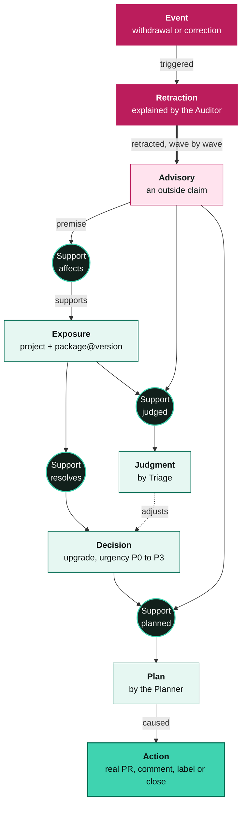
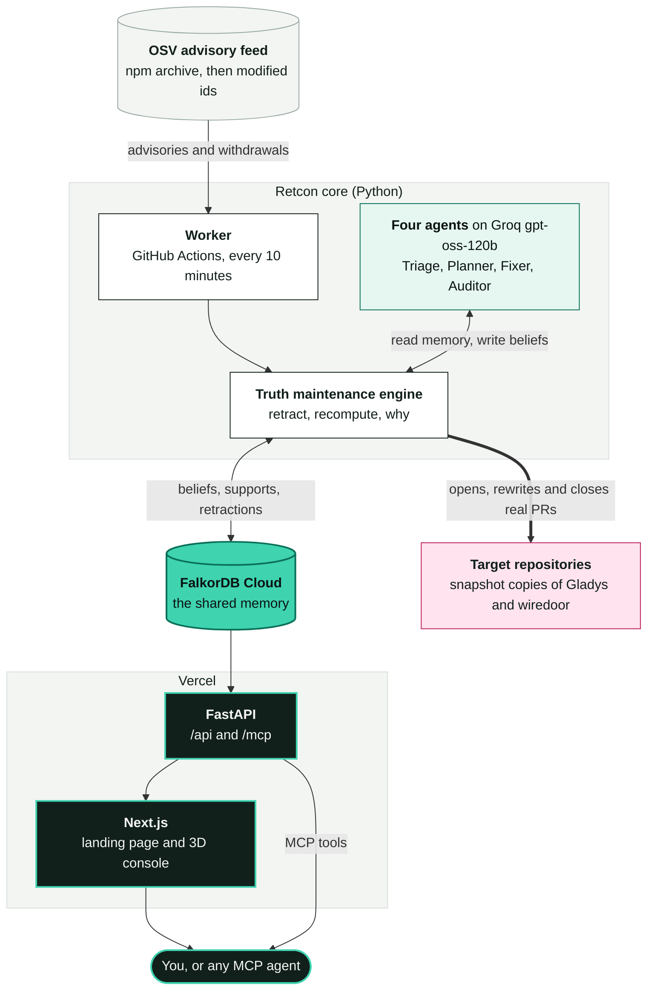

<div align="center">

<picture>
  <source media="(prefers-color-scheme: dark)" srcset="https://shieldcn.dev/header/graph.svg?title=Retcon&subtitle=Agent%20memory%20that%20can%20take%20things%20back&width=920&height=200&mode=dark&bg=0b1311&accent=3fd3b0&titleColor=e6eeea&subtitleColor=97a8a1&align=center&font=space-grotesk">
  
</picture>

[](https://github.com/Rudransh-1508/retcon/stargazers) [](https://github.com/Rudransh-1508/retcon/commits/main) [](https://github.com/Rudransh-1508/retcon/issues) 

   

[](https://retcon-kappa.vercel.app) [](https://github.com/Rudransh-1508/retcon-target-gladys/pulls?q=is%3Apr) [](#the-problem) [](#how-it-works) [](#architecture) [](#try-it) [](#use-retcon-from-your-own-agent-mcp) [](#graph-data-model-and-the-queries-retcon-depends-on) [](#running-locally)

</div>

Retcon is a team of LLM agents whose shared memory is a [FalkorDB](https://www.falkordb.com/) graph in which every belief and every decision records what supports it. It watches real security advisories for real open-source projects and turns them into real GitHub pull requests. When an advisory is withdrawn, or a person corrects a belief, Retcon revises exactly the work that rested on it, and nothing more.

        

> [!IMPORTANT]
> What holds and what is retracted is decided by the graph, never by an LLM. Agents write beliefs, and the engine rejects any belief that does not name its support.

## The problem

Advisories are not final. In GitHub's npm and PyPI advisory data, 635 have been withdrawn, 131 of them for reasons other than being a duplicate:

- **jsonwebtoken (CVE-2022-23529):** claimed remote code execution in one of npm's most used packages. Live for 36 days, then withdrawn.
- **axios (GHSA-rm8p-cx58-hcvx):** withdrawn after a day because the flaw sits in `form-data`, and patching `form-data` is enough.
- **express (GHSA-pj86-cfqh-vqx6):** withdrawn because it "describes a correctness bug, not a vulnerability".

Teams act on advisories fast: hotfixes, upgrade PRs, blocked releases. When a claim is withdrawn, nobody can say which of that work rested on it. Stale work stays open, or a naive tool undoes too much and closes work that other, still valid advisories justify. Agent memory has the same flaw: it stores conclusions without their reasons, so it cannot be revised correctly.

## How it works

Every Exposure, Judgment and Decision is **held only while at least one of its Supports holds**, and a Support holds only while **all of its premises** are held. This is a truth maintenance system ([Doyle, 1979](https://doi.org/10.1016/0004-3702(79)90008-0)) on a graph database.



<sub>**Legend:** pink is outside evidence, black circles are Supports (the reasons), green boxes are beliefs, and the bright green box is the real-world action. Solid arrows run from a premise through a Support to what it supports; the dotted arrow is a Judgment adjusting a Decision.</sub>

When an advisory is withdrawn, the retraction travels forward wave by wave and every decision it reaches gets one **outcome**:

| Outcome | Meaning | On GitHub |
|---|---|---|
| **Cancel** | No support left | The PR is closed with an explanation |
| **Downgrade** | Support left, lower urgency | The PR stays open, relabelled, with a comment |
| **Unchanged** | Other advisories still hold it up | Only the PR text is rewritten |

Nothing is ever deleted, so for any decision you can ask **"why?"** and see the full chain, including what was retracted, when, and why.

### The agents

All four agents run on Groq `gpt-oss-120b`.

| Agent | What it does |
|---|---|
| **Triage** | Finds where the project imports the affected package and calls the API the advisory names, then judges "exploitable here", "not reachable here" or "unknown", citing file and line. |
| **Planner** | At each decision point, chooses among the allowed actions (open a PR, list it in the report, keep, reopen, move to the report). Its choice is a **Plan** resting on the evidence it saw, so when that evidence is withdrawn the Plan is retracted and it plans again. A fixed **Policy** takes over if the choice is not allowed. |
| **Fixer** | Writes the prose of pull requests and comments from the decision, its plan and its why-chain. Titles, tables and links stay deterministic. |
| **Auditor** | Reads every withdrawal, classifies it (real retraction, duplicate, alias, scope change) and explains it. The graph decides outcomes; the Auditor only explains them. |

A Cancel always closes the pull request: no agent can keep work open once every advisory behind it is withdrawn.

### What the real data does

Replaying the real 2019 to 2026 advisory history against two projects (568 events, about 30 seconds locally):

- **gladys, jsonwebtoken:** four advisories land on 2022-12-22. Triage reads Gladys's code and judges the RCE claim *not reachable here*, so the upgrade is P1 and not a panic. When the claim is withdrawn on 2023-01-27, Triage's judgment is retracted with it, and the PR stays open, rewritten around the three advisories that still hold.
- **wiredoor, axios:** a PR opens on 2025-07-23, closes the next day when its advisory is withdrawn (the form-data PR is untouched), and reopens in September when new axios advisories arrive.
- **wiredoor, express:** the advisory is withdrawn and nothing else holds the decision up, so it is cancelled.
- **Duplicates** (about 80% of withdrawals) count as the same evidence as their original, so withdrawing one changes nothing and touches nothing on GitHub.

> [!NOTE]
> The demo targets are snapshot copies (not forks, so nothing can reach upstream) of [GladysAssistant/Gladys](https://github.com/GladysAssistant/Gladys) at `7eb0b2a` and [wiredoor/wiredoor](https://github.com/wiredoor/wiredoor) at `e80904f`, both Apache-2.0. The GitHub token is limited to those two repositories, and the code refuses any other.

## Try it

The first time you open the console, a short guided tour starts by itself. You can skip it and replay it from the Tour button.

1. Open the [live console](https://retcon-kappa.vercel.app/app) and pick a decision. The **Why?** panel shows its chain of support and its history.
2. Press **What if wrong?** on any advisory, exposure or judgment. Retcon copies the graph, applies the retraction to the copy, shows what would change, and deletes the copy.
3. Open **Graph** and **replay a retraction**. The graph is a 3D stack of plates (advisories, exposures, judgments, decisions, plans) you can orbit, and the recorded waves travel up through it.
4. Open **Agents** for one feed of everything each agent did, and **Timeline** for every withdrawal and correction with the Auditor's explanation.

## Use Retcon from your own agent (MCP)

Retcon's memory is an MCP server, so any agent can ask it why, and what if.

| Tool | What it does |
|---|---|
| `decisions(project?, urgency?)` | Upgrades Retcon holds, most urgent first, with their pull requests |
| `why(id)` | The chain of support behind a decision, judgment, plan or advisory, including what was retracted |
| `what_if(id)` | What would change if a belief were wrong; runs on a copy of the graph and writes nothing |
| `timeline(limit?, only_retractions?)` | Recent withdrawals and corrections, with what each changed |
| `correct(id, reason)` | Retract a belief for real (local server only, needs the admin passphrase) |

```bash
# Remote, read only
claude mcp add --transport http retcon https://retcon-kappa.vercel.app/mcp

# Local, with `correct` (uses the FalkorDB settings and passphrase from .env)
claude mcp add retcon -- uv --directory /path/to/retcon run python -m retcon.mcp_server
```

Then ask: *"Using retcon, why is there an open pull request for jsonwebtoken in gladys, and what would change if GHSA-8cf7-32gw-wr33 were wrong?"*

## Graph data model and the queries Retcon depends on

**Nodes:** `Project`, `PackageVersion`, `Advisory`, `Exposure`, `Judgment`, `Decision`, `Plan`, `Action`, `Support`, `Event`, `Retraction`, `Agent`. The beliefs (`Advisory`, `Exposure`, `Judgment`, `Decision`, `Plan`) also carry the `Belief` label.

**Relationships:** `(Support)-[:PREMISE]->(node)` and `(Support)-[:SUPPORTS]->(belief)` carry the reasons. `(Agent)-[:WROTE]->(Support)` records who wrote a reason. `(Retraction)-[:RETRACTED {wave}]->(node)` records every retraction wave. Others: `DEPENDS_ON`, `DUPLICATE_OF`, `ALIAS_OF`, `ADJUSTS`, `TRIGGERED`, `ABOUT`, `CHANGED`, `CAUSED`.

**The rule:** a belief is held while at least one of its Supports is held, and a Support is held while all of its premises are held. A write that names no premises is rejected.

**Retraction (the core algorithm).** Mark the withdrawn advisory retracted, then repeat these two queries until neither changes anything. Each round is one wave:

```cypher
// 1. A Support dies when any of its premises is retracted
MATCH (s:Support {status: 'held'})-[:PREMISE]->(p:Node {status: 'retracted'})
WITH DISTINCT s SET s.status = 'retracted', s.retracted_at = $at RETURN s.id

// 2. A belief dies when no held Support is left
MATCH (b:Belief {status: 'held'})
OPTIONAL MATCH (b)<-[:SUPPORTS]-(s:Support {status: 'held'})
WITH b, count(s) AS held WHERE held = 0
SET b.status = 'retracted', b.retracted_at = $at RETURN b.id
```

**Recomputing every held decision** (urgency, evidence, target version) from the advisories that still hold, in one traversal and one batched write:

```cypher
MATCH (d:Decision {status: 'held'})<-[:SUPPORTS]-(:Support {status: 'held'})
      -[:PREMISE]->(e:Exposure {status: 'held'})<-[:SUPPORTS]-(s:Support {status: 'held'})
      -[:PREMISE]->(a:Advisory {status: 'held'})
RETURN d.id, collect(DISTINCT [a.evidence, a.rank, s.fix, a.id])
```

**What-if** runs the real retraction on a throwaway clone, so the live graph is never written: `GRAPH.COPY <graph> <scratch>`, retract on `<scratch>`, diff the decisions, then delete `<scratch>`.

**Why?** walks `PREMISE` and `SUPPORTS` from a decision back to its advisories, including retracted nodes, because nothing is ever deleted. Writes are idempotent (`MERGE`, with an index on `id` per label), so the graph can be rebuilt from the advisory feed. The code is in [`retcon/engine.py`](retcon/engine.py).

## Architecture

Everything runs on free tiers.



- **Graph:** FalkorDB Cloud. The graph can always be rebuilt from the feed, so a restart of the free instance is harmless.
- **Worker:** a scheduled GitHub Actions workflow, every 10 minutes, plus manual `run` and `reset`.
- **Advisory feed:** the public OSV bucket (the npm archive on rebuild, the modified-id index after that). OSV's query API omits withdrawn advisories, so it is not used.
- **LLMs:** Groq, with a key pool, rotation, backoff and a fallback model.
- **API and UI:** FastAPI serverless functions plus a Next.js static export in `web/` (landing page at `/`, console at `/app`, 3D graph in three.js), all on Vercel.
- **GitHub:** a fine-grained token limited to the two target repositories.

## Running locally

```bash
docker run -d -p 6390:6379 falkordb/falkordb:latest   # tests and local dev use port 6390
uv sync
uv run pytest                                          # scenario tests against real FalkorDB
FALKORDB_HOST= RETCON_GRAPH=dev uv run python -m retcon.cli run --dry-run   # replay without touching GitHub
FALKORDB_HOST= RETCON_GRAPH=dev uv run uvicorn retcon.api:app --port 8000
cd web && npm ci && npm run dev
```

Configuration lives in `.env`: `GITHUB_TOKEN`, `GROQ_API_KEY_1..N` (or `GROQ_API_KEYS`), `FALKORDB_HOST/PORT/USERNAME/PASSWORD` (empty for local Docker) and `RETCON_ADMIN_PASSPHRASE`.

## Tests

- **Engine (Python):** the tests drive one seam, the engine, exactly as the worker and API do, against **real FalkorDB** with **real advisory and lockfile fixtures**. Only the LLM (a stub) and GitHub (an in-memory fake) are replaced. Scenarios include the real jsonwebtoken, axios, express and duplicate withdrawals, corrections, what-if, the write rule, rebuild with re-linking, and aliases.
- **Console (browser):** `cd web && npm run test:e2e` runs Playwright against the static export, answering every `/api` request from recorded responses. It covers the views, the guided tour and accessibility. See [`web/e2e/README.md`](web/e2e/README.md).

## Built with AI assistance

Retcon was built with Claude Code (Anthropic) as a coding assistant, for implementation, tests and the web UI, as the FalkorDB Graph Hacks rules allow when disclosed.
